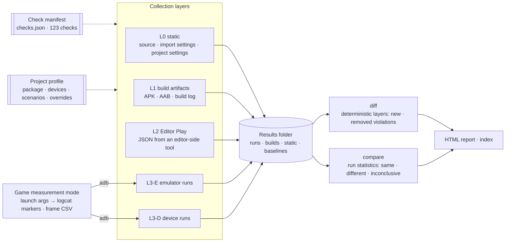

# unity-perfkit

[한국어](README.md)

A Python command-line tool (command name `perfkit`) that **measures a Unity Android game against the same criteria every time and decides, with statistics, whether a candidate build is better than a baseline**. It pins 123 checks in a single manifest file and collects them under the same item names across layers: static checks, build artifacts, Editor Play mode, emulator runs and device runs. It never judges from a single measurement: it runs baseline and candidate alternately (ABAB) several times, compares the difference with a noise floor measured on identical builds, and answers "same", "different" or "inconclusive". Emulator runs and device runs are kept in separate classes and never compared with each other, and on the emulator only relative change is judged, never absolute thresholds. It is meant for Unity mobile developers who want to catch performance regressions per pull request or per commit.

- Python standard library only. Nothing to install.
- Everything specific to a game (package name, devices, scenarios, build command, noise classes) lives in a **project profile** file outside this repository, not in the code.
- Device runs need a **measurement mode** in your game (code that takes fixed launch arguments and prints fixed lines to logcat). You write it yourself; the format is in [the Unity contract](docs/unity-contract.md).

The detailed documents under `docs/`, the CLI help text and the manifest's item texts are in **Korean**. This README covers everything you need to start; command names, options, file formats and item ids are the same in both languages.

## At a glance



L0 and L1 are deterministic (same input, same result), so `diff` compares them directly. L2 and L3 vary from run to run, so `compare` judges them with per-run statistics. Mixing classes (emulator and device) in one comparison is refused.

## Requirements

- Python 3.11 or later (developed and checked on 3.12). `tomllib`, used to read the config files, exists from 3.11.
- For device runs (L3): `adb` from the Android SDK, and a physical device with USB debugging or an Android emulator (AVD).
- Optional: the `emu-lab` CLI from [unity-emu-lab](https://github.com/cyKim0115/unity-emu-lab), an emulator lease tool. When several jobs share one emulator, perfkit takes and releases a lease around the runs. Without it, attach to a running emulator with `--no-lease`.
- For device runs, a measurement mode in your game. For L2 and editor audit merging, an editor-side tool in your project that writes the expected JSON.
- Host idle measurement works on Windows and Linux. Other systems only get an "unable to check" warning.

## Install

```
git clone https://github.com/cyKim0115/unity-perfkit.git
cd unity-perfkit
python -m perfkit --help
```

No installation needed: run `python -m perfkit` from the repository root. For a `perfkit` command, `pip install -e .`.

## Five-minute quick start

### 1. Without a device: manifest → static check → build check → diff

```
python -m perfkit manifest check
python -m perfkit config init
python -m perfkit static --project ../MyGame --out out/base/source.json
python -m perfkit build --apk builds/MyGame-base.apk --out out/base/l1.json
python -m perfkit diff out/base/l1.json
```

- If `manifest check` ends with `checks=123 areas=9 … version=1.0.0`, the manifest is fine. The `warn:` lines before it (emulator noise classes still pending, and so on) are not failures.
- `config init` creates the user config (`~/.perfkit/config.toml`). Put your project profile path (`profile`) and a results folder there and results go to that folder without `--out`. `config show` prints each value and where it came from.
- `diff <candidate>` with one file checks absolute rules only (16 KB alignment, size limits, …).

After changing code, measure the candidate with the same commands and compare:

```
python -m perfkit static --project ../MyGame --out out/cand/source.json
python -m perfkit build --apk builds/MyGame-cand.apk --out out/cand/l1.json
python -m perfkit diff out/base/l1.json out/cand/l1.json --out out/l1-diff.json --fail-on fail
python -m perfkit report out/l1-diff.json
```

`diff` gives pass / warn / fail per item plus **new and removed violations**. With `--fail-on fail` it exits with 1 when any item fails, so you can gate CI on it.

### 2. Device runs: interleaved runs → compare → report

Add a device (`[devices.emulator]`) and a scenario (`[[scenarios]]`) to your profile, and prepare two APKs with the measurement mode (baseline and candidate).

```
python -m perfkit device doctor --device emulator
python -m perfkit run abab --device emulator --a builds/MyGame-base.apk --b builds/MyGame-cand.apk --scenario town-idle --rounds 6
python -m perfkit compare --runs session:<session printed above> --split arm --report
```

- `run abab` runs baseline (A) and candidate (B) once per round in a shuffled order, reinstalling and re-injecting the save for every run.
- `compare --split arm` splits that session into A and B, answers same / different / inconclusive per metric and, with `--report`, writes an HTML file next to the comparison JSON (or run `report <comparison.json>` later).
- Without a measured noise floor, defaults per noise class are used. Measuring the same APK as A/A makes the verdict sharper and tells you how many rounds you need: `python -m perfkit noise aa --device emulator --apk builds/MyGame-base.apk --scenario town-idle --rounds 6`.
- With a build command in the profile's `[build]`, two commits are enough to go from build to report: `python -m perfkit compare --base-commit abc1234 --cand-commit def5678 --device emulator`.

## Commands

| Command | What it does | Layer |
|---|---|---|
| `config` | Show values and their sources, create the user config | – |
| `manifest` | Check, hash, list, show items, collector table | – |
| `schema` | Validate result, run-meta and comparison JSON | – |
| `verdict judge` | Try a judging rule on single values | all |
| `static` | Static check of source, import settings, project settings | L0 |
| `build` | Check APK, AAB, build log, Addressables layout | L1 |
| `diff` | Compare two deterministic results | L0·L1·L2 |
| `editor` | Read Editor Play, profiler capture and memory snapshot JSON | L2 |
| `device` | Prepare and check devices and emulators (doctor, prep, restore, wait-cool, host-gate, avd) | L3 |
| `run` | Run and collect (repeat, ABAB, cold start) | L3-E·L3-D |
| `compare` | Compare against a baseline with statistics; commit/APK pipeline | all |
| `bisect-step` | One step for `git bisect run` | all |
| `baseline` | Register, list, show baselines | all |
| `noise aa` | Noise floor from A/A runs of the same build | L3 |
| `report` | Comparison or result → single-file HTML | all |
| `index` | Index runs and comparisons (JSONL, SQLite) | – |
| `import legacy` | Old measurement logs → run folders | L3 |

Options and SPECs (`session:`, `baseline:`, `run:`, folders) are in [the command reference](docs/commands.md) (Korean).

### Exit codes

| Code | Meaning |
|---|---|
| 0 | OK |
| 1 | A check failed, or `--fail-on` matched |
| 2 | Refused or bad input (mixed classes, missing file, …) |
| 3 | Comparison invalid (probe, scenario, manifest or quality-settings hash differs), or device not ready |
| 4 | Run not started (host busy, emulator leased by someone else) |
| 5 | AVD settings differ from the expected values |
| 6 | Run folder does not match its schema |

`bisect-step` follows the `git bisect run` convention: worse 1 · same 0 · inconclusive 125 (skip) · error 128 (abort).

## The check manifest

`manifest/checks.json` holds 123 checks (+ 4 auxiliary metrics). Every result and comparison records the manifest version and hash. The item texts are in Korean.

- **Nine areas**: FRM frame budget and threads (5) · CPU runtime work (15) · SCR static script checks (9) · GPU rendering, URP (25) · MEM memory (18) · AST asset import settings (20) · BLD build and startup (13) · THM sustained performance and power (7) · STB stability, store vitals and logs (11).
- **Item ids**: `<area>-<number>` (for example `FRM-01`). A single metric is `<item>.<metric key>` (for example `FRM-01.p95`).
- **Basic and deep sets**: 73 basic checks to look at every time, 50 deep checks for narrowing down causes (`manifest list --set basic`).
- **Per-layer fields**: for every layer (`L0`, `L1`, `L2`, `L3-E`, `L3-D`, `console`) an item has a noise class (`none`, `low`, `medium`, `high`, `very_high`, `unknown`, `pending_aa`), a judging mode (`absolute+change`, `change_only`, `record`) and a collector name.
- **Fix risk `fix_risk`**: how much of the fix can be left to automation when the item gets worse (`safe`, `review`, `human`, `none`). Not used for judging.
- **Absolute thresholds**: numbers from public documentation (source URLs) and first-edition proposals. Each rule records its basis (official, proposed, set by the project).
- **Overrides in the profile**: change a project's noise classes, judging modes, absolute thresholds and layers in the profile's `[overrides]` without editing the manifest (`manifest --profile check` validates the result).

More: [the check manifest](docs/manifest.md) (Korean).

## Measurement classes and verdicts

- **Why separate classes**: an emulator borrows the host PC's CPU and GPU, so its absolute numbers say nothing about a phone, and it has no heat, GPU clock or battery at all. On the emulator (L3-E) only change is judged, and items tagged with such metrics cannot have an L3-E layer (`emulator_forbidden_tags`). An emulator improvement is marked "awaiting device confirmation".
- **ABAB interleaving**: baseline and candidate alternate in a shuffled order each round, so drifts in device temperature or host load do not land on one side only. A and B of the same round form a pair.
- **A/A noise floor and minimum detectable effect**: running the same build as A/A measures σd, "the difference you get without changing anything". The smallest change n pairs can detect (MDE) is 2.8·σd/√n, and perfkit recommends the number of rounds for a target MDE.
- **Verdict**: the effect is the Hodges-Lehmann shift (a robust "typical difference" that a single outlier barely moves); the interval is a per-run bootstrap 95% interval (re-sampling runs to get the range of the effect); the test is the Wilcoxon signed-rank test for pairs and the Mann-Whitney U test otherwise (rank-based tests).
  - **Same**: the whole interval lies within the equivalence band (±% per noise class).
  - **Different**: the interval excludes 0, p < 0.05, and the effect is larger than the noise floor. Better or worse comes from the manifest's `better`.
  - **Inconclusive**: neither, fewer than 3 runs on a side, drift (the difference grows with the round number), or state mixing. Not a failure: "not enough data to say".
- **Pairs needed for "different"**: with 5 pairs or fewer the Wilcoxon p-value cannot go below 0.05, so "different" never appears. It becomes possible from 6 pairs, which is why the commit/APK pipeline defaults to 6 rounds.
- **State-mixing check**: when values fall into a few discrete levels and the same level shows up on both sides (for example one object in the scene is visible in some runs and not in others), the difference is not treated as an effect and the verdict becomes inconclusive.
- **Host idle gate**: emulator runs record host CPU before and during measurement, the share of other editor processes and logcat reconnects; runs above the thresholds (defaults 15%, 25%, 1%, 0) are dropped from the statistics. Device runs wait for the phone to cool down first.
- **Invalid comparison**: if the probe version (`probe_hash`), scenario, manifest or quality settings differ between the sides, the numbers are not compared (exit code 3).

More: [verdicts and statistics](docs/judging.md), [collection layers](docs/layers.md) (Korean).

## The project profile

Keep one TOML file per project on the game's side and point the user config's `profile` at it. Values are looked up as environment variable → user config → profile → default.

```toml
name = "my-game"

[app]
package = "com.example.game"

[paths]
results = "perf-results"

[devices.emulator]
kind = "emulator"                    # "device" for a phone
avd = "Example_API_35"
ram_class = "4GB"
lease = "emu-lab"

[run]
saves_dir = "saves"                  # pushes saves/<save name>/* to the device
seconds = 60

[[scenarios]]
name = "town-idle"
save = "light"

[static]
project = "../MyGame"

[overrides."MEM-04".layers."L3-E"]   # fill in the emulator noise class after A/A
noise = "low"
```

The results folder grows like this:

```
perf-results/
  runs/<run_id>/        meta.json · result.json · logcat.txt · frames.csv · device_samples.csv · meminfo.txt
  sessions/             run series records
  static/ builds/ editor/   L0 · L1 · L2 results
  comparisons/ reports/     comparison JSON · HTML reports
  baselines/ noise/         baselines · A/A noise floors
  runs.jsonl · comparisons.jsonl · runs.sqlite   index
```

More: [config and project profile](docs/profile.md), [results folder](docs/results.md) (Korean).

## What the Unity side must do

perfkit never launches Unity itself. For device runs your game must follow this contract.

- **Launch arguments**: perfkit starts the game with `am start … -e unity '<args>'` and passes `-perfScenario <name> -perfSeconds <s> -perfSeed <n> -perfSave <save> -perfRunId <id> -perfQuit 0 [-perfFreeze 0|1]`. When `-perfScenario` is present the game enters measurement mode.
- **Log markers**: `[PerfRun] BEGIN|PHASE|EVENT|END … json={…}` (one-line JSON) and a `[PerfStats] …` line every second. Mark the phases to measure with PHASE `measure:true`; draw-count metrics need phases named `near` and `far`.
- **Frame CSV**: collect one row per frame and write them all at the end to `<files>/perf/<runId>.csv` (`frame,tReal,tGame,phase,dtMs,cpuMs,mainMs,renderMs,…`).
- **Determinism**: start from the same save and the same seed, and freeze scene state that would otherwise change by itself during measurement (wandering characters, timed events — a movement lock, for example). If what is drawn differs between runs, that difference becomes noise or triggers the state-mixing check. After loading, report the quality settings (graphics tier, target FPS, vSync, resolution) in a `settle` phase.
- **Probe version**: `probeHash` in BEGIN. Change it when the way you measure changes; runs with different probe versions cannot be compared. After changing the measurement code, measure the baseline again.

```csharp
if (!Args.TryGet("-perfScenario", out var scenario)) return;      // normal launch
Log($"[PerfRun] BEGIN runId={runId} json={{\"probeHash\":\"{PROBE_HASH}\",\"scenario\":\"{scenario}\"}}");
Phase("load_scene_begin"); await LoadScene(); Phase("load_scene_end");
FreezeWorld(seed); await WaitUntilSettled(); Phase("settle", quality);
foreach (var step in Steps(scenario)) { Phase(step.Name, measure: true); await step.Run(); }
WriteFramesCsv($"{Application.persistentDataPath}/perf/{runId}.csv");
Log($"[PerfRun] END runId={runId} result=ok json={{\"result\":\"ok\"}}");
```

Builds without a measurement mode still run in **compatibility mode**, but only off-app metrics come out (process memory and CPU, meminfo, startup time). The full format, the editor-side JSON (`perfkit/editor-play@1` and others) and the build-info JSON are in [the Unity contract](docs/unity-contract.md) (Korean).

## Limitations and known issues

- **Emulator metrics**: absolute values are meaningless; only change is judged. Heat, GPU clock, GPU usage, battery, power, GPU time and GPU hardware counters are not measured. Emulator noise classes all start as `pending_aa`, so L3-E item verdicts stay pending until the project runs A/A and fills them in the profile. Sensitive to host load.
- **Values missing from release builds**: per-frame GC allocation (`GC Allocated In Frame`) only exists in development builds; release builds fall back to Mono heap growth, which is a lower bound. Draw Calls and Batches counters may be unreadable in some builds (those items become "not collected"), and GC collection time and Total Reserved memory are not available from the measurement-mode log. Device profiler capture works with development builds only.
- **Items without a collector yet**: some collectors exist only as names in the manifest (`console.vitals`, `device.exit_info`, `device.gpu_counters`, `device.power`, `device.probe_state`, `editor.device_profile`, `editor.memory_snapshot`, `run.conditions`). GPU-13 (Mali Offline Compiler) is not connected either. These items stay "not collected".
- **Standard-library statistics**: bootstrap, Wilcoxon, Mann-Whitney and Spearman are implemented in-house (exact distributions for small samples, approximations for large ones). They have not been cross-checked against a general-purpose statistics package.
- **Static check (L0)**: C# source is checked with regular expressions and method ranges. The call graph is not followed, so functions called from Update are not treated as per-frame. Counts may differ from Project Auditor.
- **Scenario naming assumptions**: draw-count metrics expect phases named `near` and `far`; the UI-open hitch metric expects `EVENT kind=ui_open`.
- **Scope**: device runs are Android-only (adb). The editor-side tool for L2 and editor audit merging is not part of this repository (only its format is defined).
- **Language**: CLI help, manifest texts and the documents under `docs/` are in Korean.

## Documents (Korean)

| Document | Contents |
|---|---|
| [Command reference](docs/commands.md) | commands, options, SPECs, exit codes |
| [Collection layers](docs/layers.md) | what L0–L3 look at, run sequence, gates, metrics |
| [Check manifest](docs/manifest.md) | item fields, sets, noise classes, judging rules, overrides, collectors |
| [Verdicts and statistics](docs/judging.md) | ABAB, A/A and MDE, same / different / inconclusive, state mixing, baselines |
| [Config and project profile](docs/profile.md) | user config and profile keys, device definitions, build command |
| [Unity contract](docs/unity-contract.md) | launch arguments, log markers, frame CSV, determinism, editor JSON |
| [Results folder](docs/results.md) | folder layout, run folder, schemas, index, reports |
| [Extending](docs/extending.md) | repository layout, adding commands and collectors, tests |
| [Manifest changes](manifest/CHANGES.md) | threshold and item changes |

## License

[MIT](LICENSE)
