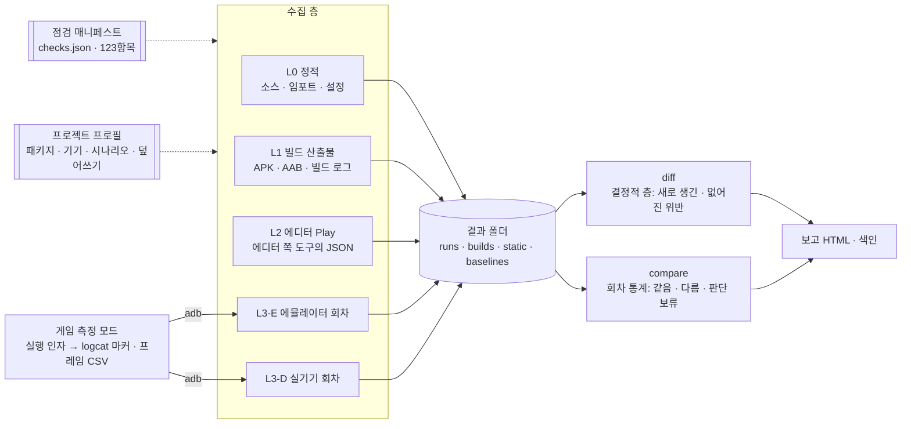

# unity-perfkit

[English](README.en.md)

Unity Android 게임의 성능을 **매번 같은 기준으로 재고, 기준 빌드 대비 나아졌는지 통계로 판정하는** 파이썬 명령줄 도구입니다(명령 이름 `perfkit`). 점검 항목 123개를 매니페스트 파일 하나에 고정해 두고, 정적 검사·빌드 산출물·에디터 Play·에뮬레이터·실기기 층에서 같은 항목 이름으로 모읍니다. 측정 한 번의 숫자로 판정하지 않습니다. 기준과 후보를 번갈아(ABAB) 여러 번 돌리고, 같은 빌드끼리 잰 잡음 바닥과 견줘 「같음·다름·판단 보류」를 냅니다. 에뮬레이터 회차와 실기기 회차는 등급을 나눠 서로 비교하지 않고, 에뮬레이터에서는 절대 기준 없이 변화만 봅니다. 성능 회귀를 PR·커밋 단위로 잡고 싶은 Unity 모바일 개발자를 위한 도구입니다.

- 파이썬 표준 라이브러리만 씁니다. 설치할 패키지가 없습니다.
- 게임마다 다른 값(패키지 이름·기기·시나리오·빌드 명령·잡음 등급)은 코드가 아니라 저장소 밖 **프로젝트 프로필** 파일에 둡니다.
- 기기 회차를 쓰려면 게임에 **측정 모드**(정해진 실행 인자를 받고 logcat에 정해진 줄을 찍는 코드)를 직접 넣어야 합니다. 형식은 [Unity 쪽 약속](docs/unity-contract.md)에 있습니다.

## 한눈에 보기



L0·L1은 같은 입력이면 같은 결과가 나오는 결정적 층이라 `diff`로 그대로 비교합니다. L2·L3는 회차마다 흔들리므로 `compare`가 회차 단위 통계로 판정합니다. 등급이 다른 회차(에뮬레이터·실기기)를 한 비교에 섞으면 거부합니다.

## 필요한 것

- Python 3.11 이상(3.12에서 개발·확인). 설정 파일을 읽는 `tomllib`가 3.11부터 있습니다.
- 기기 회차(L3)를 쓸 때: Android SDK의 `adb`, 그리고 USB 디버깅을 켠 실기기나 Android 에뮬레이터(AVD).
- (선택) 에뮬레이터 임대 도구 [unity-emu-lab](https://github.com/cyKim0115/unity-emu-lab)의 `emu-lab` CLI. 여러 작업이 같은 에뮬레이터를 쓸 때 회차 앞뒤로 임대·반납합니다. 없으면 이미 띄운 에뮬레이터에 `--no-lease`로 붙습니다.
- (기기 회차) 게임 쪽 측정 모드. (L2·에디터 점검 합치기) 정해진 JSON을 쓰는 프로젝트 안 에디터 도구.
- 호스트 유휴 측정은 Windows·Linux에서 됩니다. 그 밖의 OS는 「확인 못 함」 경고만 남깁니다.

## 설치

```
git clone https://github.com/cyKim0115/unity-perfkit.git
cd unity-perfkit
python -m perfkit --help
```

설치 없이 저장소 루트에서 `python -m perfkit`로 씁니다. `perfkit` 명령으로 쓰고 싶으면 `pip install -e .`.

## 5분 빠른 시작

### 1. 기기 없이: 매니페스트 → 정적 점검 → 빌드 점검 → diff

```
python -m perfkit manifest check
python -m perfkit config init
python -m perfkit static --project ../MyGame --out out/base/source.json
python -m perfkit build --apk builds/MyGame-base.apk --out out/base/l1.json
python -m perfkit diff out/base/l1.json
```

- `manifest check`가 `checks=123 areas=9 … version=1.0.0`로 끝나면 매니페스트가 정상입니다. 앞의 `warn:` 줄(에뮬레이터 잡음 등급 대기 등)은 실패가 아닙니다.
- `config init`이 사용자 설정(`~/.perfkit/config.toml`)을 만듭니다. 여기에 프로젝트 프로필 경로(`profile`)와 결과 폴더를 적으면 `--out` 없이 결과 폴더에 쌓입니다. `config show`로 값과 출처를 봅니다.
- `diff <후보>` 하나만 주면 절대 기준(16KB 정렬, 크기 한도 등)만 봅니다.

코드를 고친 뒤 같은 명령으로 후보를 재고 기준과 맞댑니다.

```
python -m perfkit static --project ../MyGame --out out/cand/source.json
python -m perfkit build --apk builds/MyGame-cand.apk --out out/cand/l1.json
python -m perfkit diff out/base/l1.json out/cand/l1.json --out out/l1-diff.json --fail-on fail
python -m perfkit report out/l1-diff.json
```

`diff`는 항목마다 통과·경고·실패와 **새로 생긴 위반·없어진 위반**을 냅니다. `--fail-on fail`이면 실패 항목이 있을 때 종료 코드 1이라 CI에 걸 수 있습니다.

### 2. 기기 회차: 교차 실행 → compare → report

프로필에 기기(`[devices.emulator]`)와 시나리오(`[[scenarios]]`)를 적고, 게임에 측정 모드를 넣은 APK 두 개(기준·후보)를 준비합니다.

```
python -m perfkit device doctor --device emulator
python -m perfkit run abab --device emulator --a builds/MyGame-base.apk --b builds/MyGame-cand.apk --scenario town-idle --rounds 6
python -m perfkit compare --runs session:<위에서 나온 세션> --split arm --report
```

- `run abab`은 라운드마다 기준(A)·후보(B)를 섞은 순서로 한 번씩 돌립니다. 회차마다 다시 설치하고 세이브를 다시 넣습니다.
- `compare --split arm`은 그 세션을 A·B로 나눠 지표마다 같음·다름·판단 보류를 내고, `--report`면 비교 JSON 옆에 HTML을 씁니다(`report <비교.json>`으로 따로 만들 수도 있습니다).
- 잡음 바닥이 없으면 등급별 기본값을 씁니다. 같은 APK를 A/A로 재 두면 판정이 정확해지고 필요한 라운드 수도 알 수 있습니다: `python -m perfkit noise aa --device emulator --apk builds/MyGame-base.apk --scenario town-idle --rounds 6`.
- 빌드 명령을 프로필 `[build]`에 적어 두면 커밋 두 개만 주고 빌드부터 보고까지 한 번에 갑니다: `python -m perfkit compare --base-commit abc1234 --cand-commit def5678 --device emulator`.

## 명령 한눈에

| 명령 | 하는 일 | 층 |
|---|---|---|
| `config` | 설정 값과 출처 보기, 사용자 설정 만들기 | – |
| `manifest` | 매니페스트 검사·해시·목록·항목 보기·수집기 표 | – |
| `schema` | 결과·회차 메타·비교 JSON 스키마 검사 | – |
| `verdict judge` | 판정 규칙을 값 하나로 시험 | 모든 층 |
| `static` | 소스·임포트 설정·프로젝트 설정 정적 점검 | L0 |
| `build` | APK·AAB·빌드 로그·Addressables 레이아웃 점검 | L1 |
| `diff` | 결정적 결과 두 개 비교 | L0·L1·L2 |
| `editor` | 에디터 Play·프로파일러 캡처·메모리 스냅숏 JSON 읽기 | L2 |
| `device` | 기기·에뮬레이터 준비와 점검(doctor·prep·restore·wait-cool·host-gate·avd) | L3 |
| `run` | 회차 실행·수집(반복·ABAB·콜드 시작) | L3-E·L3-D |
| `compare` | 기준 대비 비교·통계 판정, 커밋·APK 파이프라인 | 모든 층 |
| `bisect-step` | `git bisect run`용 한 단계 | 모든 층 |
| `baseline` | 기준선 등록·목록·보기 | 모든 층 |
| `noise aa` | 같은 빌드 A/A 회차로 잡음 바닥 | L3 |
| `report` | 비교·점검 결과 → 한 파일 HTML | 모든 층 |
| `index` | 회차·비교 색인(JSONL·SQLite) | – |
| `import legacy` | 옛 측정 로그 → 회차 폴더 | L3 |

옵션과 SPEC(`session:`·`baseline:`·`run:`·폴더)은 [명령 참조](docs/commands.md).

### 종료 코드

| 코드 | 뜻 |
|---|---|
| 0 | 정상 |
| 1 | 검사 실패 또는 `--fail-on`에 걸림 |
| 2 | 거부·입력 오류(등급 혼용, 파일 없음 등) |
| 3 | 비교 무효(측정 코드·시나리오·매니페스트·품질 설정 해시가 다름), 또는 기기 준비 실패 |
| 4 | 회차를 시작하지 않음(호스트가 바쁨, 남의 에뮬레이터 임대) |
| 5 | AVD 설정이 기대값과 다름 |
| 6 | 회차 폴더가 스키마에 맞지 않음 |

`bisect-step`은 `git bisect run` 약속을 따릅니다: 악화 1 · 같음 0 · 판단 보류 125(건너뜀) · 오류 128(중단).

## 점검 매니페스트

`manifest/checks.json`에 항목 123개(+ 보조 지표 4개)가 있습니다. 모든 결과·비교에 매니페스트 버전과 해시가 남습니다. 항목 문구는 한국어입니다.

- **영역 9개**: FRM 프레임 예산·스레드(5) · CPU 런타임 연산(15) · SCR 스크립트 정적 점검(9) · GPU 렌더링(URP)(25) · MEM 메모리(18) · AST 리소스 임포트 설정(20) · BLD 빌드·시작(13) · THM 기기 지속성·전력(7) · STB 안정성·스토어 지표·로그(11).
- **항목 id**: `<영역>-<번호>`(예: `FRM-01`). 지표 하나는 `<항목>.<지표 키>`(예: `FRM-01.p95`)로 가리킵니다.
- **기본/심화 세트**: 매번 보는 기본 73개, 원인을 좁힐 때 보는 심화 50개(`manifest list --set basic`).
- **층별 칸**: 항목마다 층(`L0`·`L1`·`L2`·`L3-E`·`L3-D`·`console`)별로 잡음 등급(`none`·`low`·`medium`·`high`·`very_high`·`unknown`·`pending_aa`)과 판정 방식(`absolute+change`·`change_only`·`record`), 수집기 이름이 있습니다.
- **안전 범위 `fix_risk`**: 나빠졌을 때 고치는 일을 얼마나 맡겨도 되는지(`safe`·`review`·`human`·`none`). 판정에는 쓰지 않습니다.
- **절대 기준**: 공개 문서 수치(출처 URL)와 1판 제안값. 규칙마다 근거(공식·제안·프로젝트가 정함)를 적습니다.
- **프로필로 덮어쓰기**: 매니페스트를 고치지 않고 프로필 `[overrides]`에서 이 프로젝트의 잡음 등급·판정 방식·절대 기준·층을 바꿉니다(`manifest --profile check`로 검사).

자세히: [점검 매니페스트](docs/manifest.md).

## 측정 등급과 판정

- **등급을 나누는 이유**: 에뮬레이터는 호스트 PC의 CPU·GPU를 빌려 써서 절대값이 실기기와 무관하고, 발열·GPU 클럭·배터리는 아예 없습니다. 그래서 에뮬레이터(L3-E)에서는 변화만 보고, 그런 지표가 붙은 항목은 L3-E에 두지 않습니다(`emulator_forbidden_tags`). 에뮬레이터에서 개선으로 나오면 「실기기 확인 대기」가 붙습니다.
- **ABAB 교차**: 기준과 후보를 라운드마다 섞은 순서로 번갈아 돌려, 그 사이 기기 온도·호스트 부하 변화가 한쪽에만 몰리지 않게 합니다. 같은 라운드의 A·B가 한 쌍입니다.
- **A/A 잡음 바닥과 최소 탐지 변화**: 같은 빌드를 A/A로 재 「아무것도 안 바꿔도 나는 차이」 σd를 잽니다. n쌍으로 잡을 수 있는 가장 작은 변화(MDE)는 2.8·σd/√n이고, 목표 MDE에 필요한 라운드 수를 권고합니다.
- **판정**: 효과는 Hodges-Lehmann 이동량(튀는 값에 덜 흔들리는 차이의 대표값), 구간은 회차 단위 부트스트랩 95% 구간(회차를 다시 뽑아 효과의 범위를 잡음), 검정은 쌍이면 Wilcoxon 부호순위·아니면 Mann-Whitney U(순위로 보는 검정).
  - **같음**: 구간 전체가 동등 범위(잡음 등급별 ±%) 안.
  - **다름**: 구간이 0을 품지 않고, p < 0.05이고, 효과가 잡음 바닥보다 큼. 방향(개선·악화)은 매니페스트의 `better`.
  - **판단 보류**: 둘 다 아님, 한쪽 회차 3회 미만, 드리프트(라운드가 갈수록 차이가 커짐), 상태 섞임. 실패가 아니라 「데이터가 모자람」입니다.
- **「다름」에 필요한 쌍 수**: 쌍 5개 이하에서는 Wilcoxon p가 0.05 아래로 내려가지 못해 「다름」이 나오지 않습니다. 6쌍부터 가능하고, 커밋·APK 비교의 기본 라운드가 6인 이유입니다.
- **상태 섞임 검사**: 값이 몇 개 수준으로만 나뉘고 같은 수준이 양쪽에 함께 나오면(예: 회차마다 장면 안 오브젝트 하나가 보이고 안 보임) 그 차이를 효과로 보지 않고 판단 보류로 내립니다.
- **호스트 유휴 관문**: 에뮬레이터 회차는 측정 전·중 호스트 CPU, 다른 에디터 프로세스 점유, logcat 재연결을 기록하고 문턱(기본 15%·25%·1%·0회)을 넘은 회차를 통계에서 뺍니다. 프로필로 켜는 관문 둘: 열린 다른 에디터 수(`other_editors_max`, CPU를 안 써도 호스트 GPU를 나눠 에뮬레이터가 느려지는 경우)와 회차 뒤 상태 검사(`health`, 정상이면 나와야 할 값의 하한·상한). 실기기는 회차 전 열이 식을 때까지 기다립니다.
- **비교 무효**: 측정 코드 판(`probe_hash`)·시나리오·매니페스트·품질 설정이 양쪽에서 다르면 숫자를 맞대지 않습니다(종료 코드 3).

자세히: [판정과 통계](docs/judging.md), [수집 층](docs/layers.md).

## 프로젝트 프로필

프로젝트마다 TOML 파일 하나를 게임 저장소 쪽에 두고, 사용자 설정의 `profile`로 가리킵니다. 값은 환경 변수 → 사용자 설정 → 프로필 → 기본값 순으로 찾습니다. 경로에는 `~`와 환경 변수(`${VAR}`)를 쓸 수 있고 상대 경로는 프로필 폴더 기준이라, PC마다 다른 위치를 환경 변수로 적으면 같은 프로필을 여러 PC에서 씁니다. 임대 도구·빌드 명령 없이 쓰는 법은 [설정과 프로젝트 프로필](docs/profile.md#이-pc-전용-도구-없이-쓰기).

```toml
name = "my-game"

[app]
package = "com.example.game"

[paths]
results = "perf-results"

[devices.emulator]
kind = "emulator"                    # 실기기는 "device"
avd = "Example_API_35"
ram_class = "4GB"
lease = "emu-lab"

[run]
saves_dir = "saves"                  # saves/<세이브 이름>/* 를 기기에 넣음
seconds = 60

[[scenarios]]
name = "town-idle"
save = "light"

[static]
project = "../MyGame"

[overrides."MEM-04".layers."L3-E"]   # A/A를 잰 뒤 에뮬레이터 잡음 등급 채우기
noise = "low"
```

결과 폴더는 이렇게 쌓입니다.

```
perf-results/
  runs/<run_id>/        meta.json · result.json · logcat.txt · frames.csv · device_samples.csv · meminfo.txt
  sessions/             여러 회차 실행 기록
  static/ builds/ editor/   L0 · L1 · L2 결과
  comparisons/ reports/     비교 JSON · 보고 HTML
  baselines/ noise/         기준선 · A/A 잡음 바닥
  runs.jsonl · comparisons.jsonl · runs.sqlite   색인
```

자세히: [설정과 프로젝트 프로필](docs/profile.md), [결과 폴더](docs/results.md).

## Unity 쪽이 지킬 약속

perfkit은 Unity를 직접 부르지 않습니다. 기기 회차에서는 게임이 아래를 지켜야 합니다.

- **실행 인자**: perfkit이 `am start … -e unity '<인자>'`로 `-perfScenario <이름> -perfSeconds <초> -perfSeed <n> -perfSave <세이브> -perfRunId <id> -perfQuit 0 [-perfFreeze 0|1]`을 넘깁니다. 게임은 `-perfScenario`가 있으면 측정 모드로 들어갑니다.
- **로그 마커**: `[PerfRun] BEGIN|PHASE|EVENT|END … json={…}`(한 줄 JSON)과 1초마다 `[PerfStats] …` 줄. 측정할 단계는 PHASE `measure:true`로 표시하고, 그리기 수 지표에는 근경·원경 단계(기본 이름 `near`·`far`, 프로필에서 바꿈)가 필요합니다.
- **프레임 CSV**: 프레임마다 한 줄을 모아 끝날 때 `<files>/perf/<runId>.csv`에 한 번에 씁니다(`frame,tReal,tGame,phase,dtMs,cpuMs,mainMs,renderMs,…`).
- **결정성**: 같은 세이브·같은 씨에서 시작하고, 캐릭터 배회·시간 사건처럼 측정 중 저절로 바뀌는 장면 상태를 고정(이동 잠금 등)합니다. 회차마다 그려지는 것이 다르면 그 차이가 그대로 잡음이 되거나 상태 섞임으로 판단 보류가 납니다. 로딩이 끝난 뒤 `settle` 단계에서 품질 설정(그래픽 등급·목표 FPS·vSync·해상도)을 적습니다.
- **측정 코드 판**: BEGIN의 `probeHash`. 측정 방식이 바뀌면 이 값을 바꾸고, 판이 다른 회차끼리는 비교가 무효입니다. 측정 코드를 바꾸면 기준선을 다시 잽니다.

```csharp
if (!Args.TryGet("-perfScenario", out var scenario)) return;      // 일반 실행
Log($"[PerfRun] BEGIN runId={runId} json={{\"probeHash\":\"{PROBE_HASH}\",\"scenario\":\"{scenario}\"}}");
Phase("load_scene_begin"); await LoadScene(); Phase("load_scene_end");
FreezeWorld(seed); await WaitUntilSettled(); Phase("settle", quality);
foreach (var step in Steps(scenario)) { Phase(step.Name, measure: true); await step.Run(); }
WriteFramesCsv($"{Application.persistentDataPath}/perf/{runId}.csv");
Log($"[PerfRun] END runId={runId} result=ok json={{\"result\":\"ok\"}}");
```

측정 모드가 없는 빌드도 **호환 모드**로 돌릴 수 있지만 기기 밖 지표(프로세스 메모리·CPU, meminfo, 시작 시간)만 나옵니다. 전체 형식, 에디터 쪽 도구 JSON(`perfkit/editor-play@1` 등), 빌드 정보 JSON은 [Unity 쪽 약속](docs/unity-contract.md).

## 한계와 알려진 문제

- **에뮬레이터 지표**: 절대값은 의미가 없고 변화만 봅니다. 발열·GPU 클럭·GPU 사용량·배터리·전력·GPU 시간·GPU 하드웨어 카운터는 재지 않습니다. 에뮬레이터 잡음 등급은 처음에 모두 `pending_aa`라, 프로젝트가 A/A를 재고 프로필에서 채우기 전에는 L3-E 항목 판정이 보류됩니다. 호스트 부하에 민감합니다.
- **릴리스 빌드에서 안 나오는 값**: 프레임별 GC 할당(`GC Allocated In Frame`)은 개발 빌드에서만 나옵니다. 릴리스에서는 Mono 힙 증가분으로 대신하며 하한값입니다. Draw Calls·Batches 카운터는 빌드에 따라 못 읽을 수 있고(그 항목은 「수집 못 함」), GC 수집 시간·Total Reserved 메모리는 측정 모드 로그로 못 잽니다. 기기 프로파일러 캡처는 개발 빌드에서만 됩니다.
- **수집기가 아직 없는 항목**: 매니페스트에 이름만 있는 수집기가 9개 있습니다(`console.vitals`, `device.exit_info`, `device.gpu_counters`, `device.power`, `device.probe_state`, `editor.device_profile`, `editor.memory_snapshot`, `run.conditions`, GPU-13의 `build.malioc`). `manifest collectors`에 「예정」으로 나오고, 이 항목들은 「수집 못 함」으로 남습니다.
- **표준 라이브러리 통계**: 부트스트랩·Wilcoxon·Mann-Whitney·Spearman을 직접 구현했습니다(작은 표본은 정확 분포, 큰 표본은 근사). 범용 통계 패키지로 교차 검증한 것은 아닙니다.
- **정적 점검(L0)**: C# 소스를 정규식과 메서드 범위로 검사합니다. 호출 그래프는 따라가지 않아 Update가 부르는 함수 안은 「매 프레임」으로 보지 않습니다. Project Auditor와 수가 다를 수 있습니다.
- **시나리오 이름 가정**: 그리기 수 지표는 근경·원경 단계 이름(기본 `near`·`far`, 프로필 `[run] count_phases`로 바꿈)을, UI 열기 히치는 `EVENT kind=ui_open`을 기대합니다(이벤트 종류는 바꿀 수 없음).
- **범위**: 기기 회차는 Android(adb)만 됩니다. L2와 에디터 점검 합치기에 쓰는 에디터 쪽 도구는 이 저장소에 없습니다(형식만 정합니다).
- **언어**: 명령 도움말, 매니페스트 문구, `docs/` 문서는 한국어입니다.

## 문서

| 문서 | 내용 |
|---|---|
| [명령 참조](docs/commands.md) | 명령·옵션·SPEC·종료 코드 |
| [수집 층](docs/layers.md) | L0~L3가 보는 것, 회차 순서, 관문, 지표 |
| [점검 매니페스트](docs/manifest.md) | 항목 칸, 세트, 잡음 등급, 판정 규칙, 덮어쓰기, 수집기 |
| [판정과 통계](docs/judging.md) | ABAB, A/A·MDE, 같음·다름·판단 보류, 상태 섞임, 기준선 |
| [설정과 프로젝트 프로필](docs/profile.md) | 사용자 설정·프로필 키, 기기 정의, 빌드 명령 |
| [Unity 쪽 약속](docs/unity-contract.md) | 실행 인자, 로그 마커, 프레임 CSV, 결정성, 에디터 JSON |
| [결과 폴더](docs/results.md) | 폴더 구조, 회차 폴더, 스키마, 색인, 보고 |
| [모듈 더하기](docs/extending.md) | 저장소 구조, 명령·수집기 더하기, 테스트 |
| [매니페스트 변경 기록](manifest/CHANGES.md) | 기준값·항목 변경 |
| [Claude Code 스킬 틀](examples/claude-skill/README.md) | 에이전트가 perfkit을 금지·관문·세 흐름 순서로 돌리게 하는 `SKILL.md` 틀 |

## 라이선스

[MIT](LICENSE)
